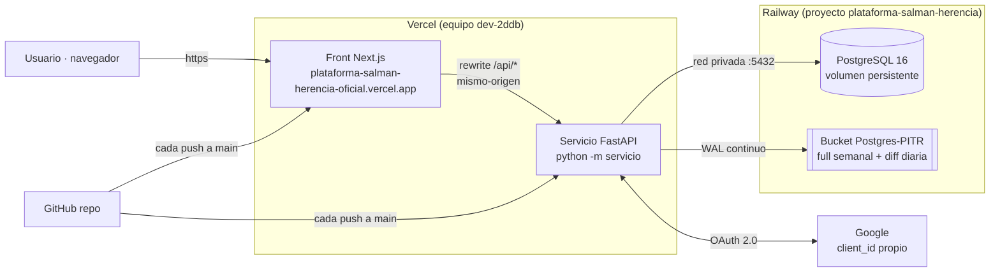

# Arquitectura funcional (2026-11-02)

HECHO DOCUMENTADO. Topología de producción verificada el 2026-11-02.

## Componentes



## Cómo viaja una llamada típica (ej. abrir sesión)

```mermaid
sequenceDiagram
    participant B as Navegador
    participant V as Front (Vercel)
    participant S as Servicio (Railway)
    participant D as PostgreSQL
    B->>V: POST /api/sesion (usuario, clave)
    V->>S: POST /sesion (proxificado, mismo-origen)
    S->>D: verifica usuario (argon2id), freno por usuario
    D-->>S: credenciales OK
    S->>D: INSERT sesión (sid, expira en 12 h) + auditoría
    S-->>V: 200 + Set-Cookie sid (HttpOnly; Secure; SameSite=None)
    V-->>B: 200 (la cookie es del dominio del front: first-party)
```

## Decisiones de despliegue que explican el diseño

- **Mismo-origen (`/api/*`)**: el front solo habla con su propio dominio; Vercel
  proxifica al servicio. Elimina CORS y el bloqueo de cookies de terceros que
  sufría el esquema front-Vercel ↔ API-Railway cross-site (2026-11-02).
- **Backend en Railway (no serverless)**: el dominio hotel necesita proceso
  continuo (sesiones en memoria, freno de logins por proceso, tareas). La API
  en Vercel serverless quedó descartada tras una prueba (proyecto `-ag24`,
  eliminado el 2026-11-02).
- **PostgreSQL gestionado por Railway con PITR**: imagen propia
  `ghcr.io/railwayapp-templates/postgres-ssl:16` (las imágenes oficiales no
  archivan WAL), volumen en `/var/lib/postgresql/data` con `PGDATA` en
  subdirectorio (el `lost+found` del volumen impide montarlo como raíz).
- **Auto-deploy**: GitHub App de Railway (servicio) y conexión GitHub de Vercel
  (front); todo push a `main` reconstruye ambos. Vercel Hobby exige autor del
  commit `hotelherenciacl@gmail.com` (regla `includeIf` en la máquina).
- **Secretos solo en variables de despliegue**: el repo no lleva `.env`;
  rotación pendiente documentada en el issue #275.
- **Contrato de errores**: todas las respuestas de error usan
  `{"detail": ...}` (estándar FastAPI); el front los interpreta con
  `mensajeDeError()` (incluye validaciones 422 campo a campo).

## Verificaciones de producción (2026-11-02)

`/api/salud` → 200 · login usuario/clave → 200 con cookie · Google
`configurado:true` con consentimiento válido · freno 401×5→429 · CORS
restringido al origen del front (capa restante por el proxificado) · cabeceras
`nosniff/DENY/no-referrer` · 401 en endpoints sin sesión · suite del servicio
125 pruebas (20 fallos preexistentes del adaptador ADP en curso del
propietario).
