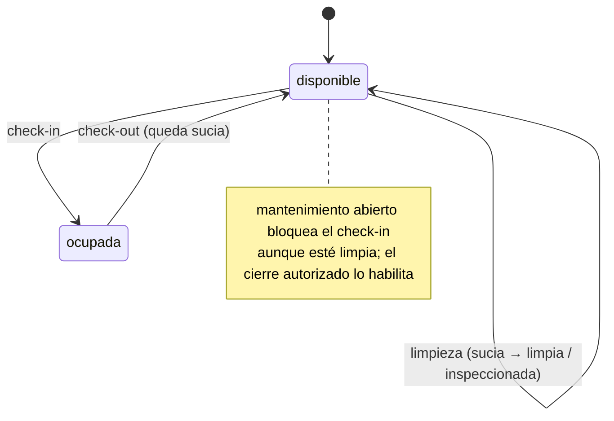

# Dominio: entidades, estados y reglas (2026-11-02)

HECHO DOCUMENTADO. Modelo funcional tal como vive en PostgreSQL y en el
servicio. El dominio decide; la base de datos proyecta.

## Entidades principales

| Entidad | Qué es | Notas |
|---|---|---|
| Empresa | Aislamiento multi-tenant | toda operación queda atada a `empresa_id` (hoy `EMP-SINTETICA-001`) |
| Usuario | Quien opera | rol `administrador`/`recepcion`/`caja`; nombre de usuario único por empresa; TOTP opcional |
| Sesión | Acceso vigente | `sid` en cookie HttpOnly/Secure (12 h), revocable individual o por usuario |
| Habitación | Unidad vendible | doble estado (ver diagrama) + bandera de mantenimiento + tareas operativas |
| Tarifa | Precio por noche | con vigencia: sin tarifa vigente no hay oferta ni reserva |
| Reserva | Compromiso de estadía | ciclo de estados (ver diagrama); documento del huésped opcional (la entrada no lo exige en V1, ver «Entrada») |
| Pago / Cargo | Movimientos de la cuenta | pagos manuales por rol autorizado; cargos en estadía (minibar etc.) |
| Auditoría | Trazabilidad | actor, acción, recurso, resultado en cada mutación |

## Ciclo de vida de la reserva

```mermaid
stateDiagram-v2
    [*] --> confirmada : POST /hotel/reservas (con cupo y tarifa vigente)
    confirmada --> en_estadia : entrada (habitación lista)
    confirmada --> cancelada : cancelación (dentro de plazo sin cargo; fuera: primera noche)
    en_estadia --> finalizada : salida (liquidación)
    en_estadia --> cancelada : cancelación con saldo a favor (sin reembolso automático)
    cancelada --> [*]
    finalizada --> [*]
```

## Estados de la habitación (doble dimensión)

Proyección técnica: `estado_operativo` (disponible/ocupada) ×
`estado_preparacion` (limpia/sucia/inspeccionada) + bandera `mantenimiento`.

## Reglas de negocio citadas en las pruebas del dominio

- **Última unidad con cupo**: cien intentos concurrentes → máximo una
  confirmación; la oferta sin vigencia queda pendiente y escala a atención
  humana.
- **Turnover**: la limpieza completa solo cambia la preparación; las fechas de
  mantenimiento quedan intactas; unidad sucia hoy puede venderse en fecha
  futura.
- **Entrada** (corregido 2026-11-03, V1-ISSUE-14): exige la habitación lista
  (sin mantenimiento abierto, ni `bloqueada` ni `fuera_de_servicio` —
  `ocupada` no bloquea el turnover—, limpia o inspeccionada, sin otra estadía
  solapada); **no** exige documento ni hora de llegada y se acepta
  antes del día de inicio (contrato vigente, spec-api-v1 «Operación de la
  habitación»). No asienta cargos: el alojamiento completo nace al confirmar
  la reserva. El dominio en memoria sí exige 15:00 del día de inicio y
  documento; adoptar esa regla es la DECISIÓN PENDIENTE D-ENT-01
  (V1-ISSUE-07).
- **Caja**: conciliación del día con pagos y cargos; solo roles autorizados.
- **Idempotencia en todo POST de mutación** (cl `Idempotency-Key`): reintento
  seguro de red y de usuario; 409 ante clave reutilizada con cuerpo distinto.
- **Freno de fuerza bruta**: 5 fallos de login en 5 minutos bloquean al usuario
  5 minutos (en memoria de proceso).
- **Sin sistemas externos reales** (AGENTS.md): Webpay/Mercado Pago/SII/
  Booking/WhatsApp existen solo como puertos; sin adaptador responden 503
  «no configurado» y la API devuelve estado pendiente.
- **Tope de solicitudes por cliente** (#348, decisión del propietario
  2026-11-18): un mismo contacto (correo en minúsculas o teléfono
  normalizado, `+56` para móviles chilenos) puede tener como máximo
  `max_solicitudes` solicitudes `recibida` o `convertida` en los últimos
  `dias` días; la siguiente responde 409 y no se guarda. Las rechazadas no
  cuentan y un reintento con la misma `Idempotency-Key` tampoco. Valor
  inicial 3 en 7 días, activo; lo cambia la administración del hotel en
  Configuración → «Reservas web» (`PUT /hotel/ajustes/tope_solicitudes_cliente`).
  No hay cupo por canal: el límite físico es la disponibilidad por tipo.
- **Lead contactado por correo** (#355, decisión del propietario
  2026-11-18): la plataforma revisa cada 15 minutos (configurable) la
  carpeta de enviados de los buzones de lectura configurados en
  Configuración → «Correo». Si hay un correo enviado al correo de un lead
  `nuevo` con fecha posterior a su creación, el lead pasa a `contactado`
  con la nota «auto: correo enviado desde <buzón> el <fecha>» y autor
  `auto:correo`. Solo se leen destinatarios y fecha (nunca asunto ni
  cuerpo). Ese contacto automático se puede deshacer (vuelve a `nuevo`);
  uno manual, no. Guía de configuración: `docs/operacion/correo.md`.

## Pantallas del front (mapa a operaciones)

| Pantalla | Operaciones que consume |
|---|---|
| Login | `POST /sesion`, `DELETE /sesion`, Google estado/callback |
| Oferta | `GET /hotel/oferta` |
| Reserva | `POST /hotel/reservas` |
| Reservas | `GET /hotel/reservas` (filtros fecha/estado/texto) |
| Pago | `POST /hotel/reservas/{id}/pagos` |
| Estadía | entrada, cargos, cancelación |
| Salida | `POST /hotel/reservas/{id}/salida` |
| Caja | `GET /hotel/caja?fecha` |
| Habitaciones | alta/edición (PUT), limpieza, mantenimiento |
| Usuarios | alta, cambio de clave, revocación, baja |
| Cuenta | TOTP: activar, QR, desactivar |
