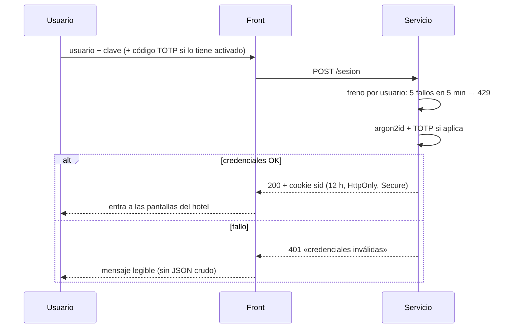
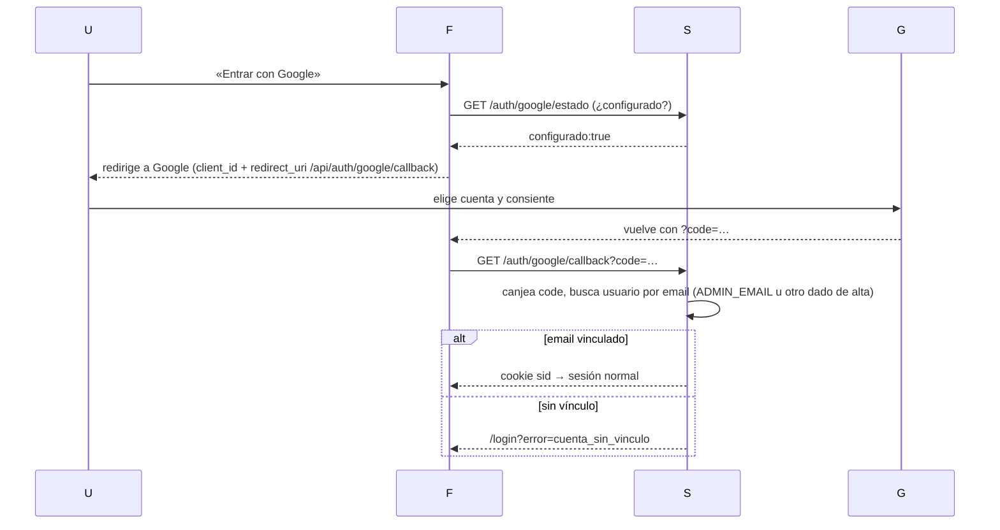
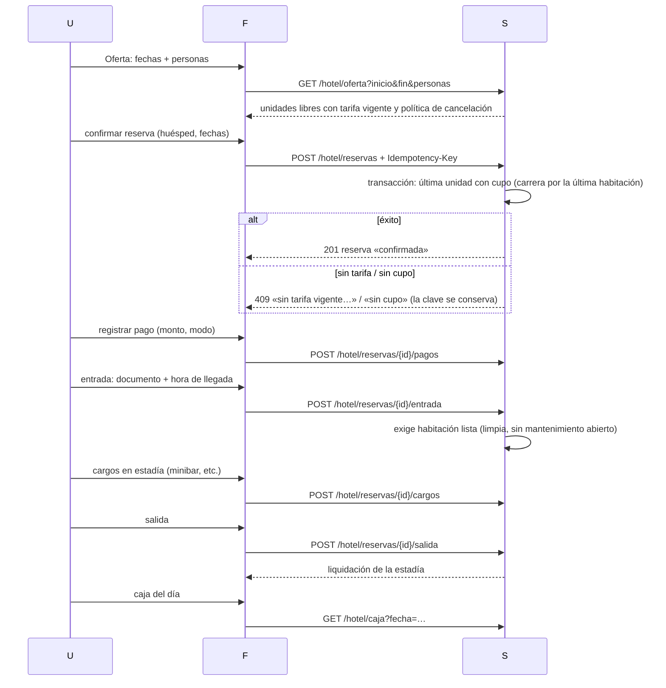

# Flujos funcionales (2026-11-02)

HECHO DOCUMENTADO. Secuencias de lo que el usuario vive y qué decide el
backend en cada paso.

## 1. Acceso con usuario y clave



- El freno cuenta por **usuario** (no por IP): los proxies de borde rotan la
  IP y el contador clásico por (ip, usuario) nunca se activaba (bug real
  corregido el 2026-11-02, commit `8780cc0`).
- Roles: `administrador`, `recepcion`, `caja`; varias operaciones exigen rol
  (pago manual, caja, limpieza, mantenimiento, gestión de usuarios).

## 2. Acceso con Google



## 3. Ciclo de venta (el corazón del hotel)



- **Idempotencia**: la clave nace en el formulario, se muestra antes de enviar y
  sobrevive errores; tras un 2xx se renueva. Reintentar con la misma clave y
  distinto cuerpo → 409 (no se acuña en silencio).
- **Pagos**: pasarela externa existe solo como puerto — sin configurar responde
  503 «pasarela no configurada» (estado «pendiente»), nunca cobra de verdad.
- **Cancelación** (desde Estadía): dentro de plazo sin cargos; fuera de plazo
  carga la primera noche; el saldo a favor queda sin reembolso automático.

## 4. Housekeeping (habitaciones)

```mermaid
sequenceDiagram
    U->>F: marcar limpieza (HAB-…)
    F->>S: POST /hotel/habitaciones/{id}/limpieza
    S->>S: cierra tareas de limpieza pendientes; sucia → limpia
    S-->>F: habitacion_id + estado_preparacion + tareas_completadas
    U->>F: abrir mantenimiento
    F->>S: POST /hotel/habitaciones/{id}/mantenimiento
    S-->>F: habitación bloqueada para check-in hasta el cierre autorizado
```

## 5. Gestión de usuarios (solo administrador)

Alta (nombre, usuario único por empresa, rol, clave), cambio de clave,
revocación de sesiones y baja. El **último administrador activo no se puede
dar de baja** (409). La revocación echa a ese usuario de todas sus sesiones.

## Reglas duras transversales

- **API caída → error y nada confirmable**: si el front no alcanza al backend,
  muestra aviso y ninguna operación se confirma (spec-front-v1).
- **La verdad la tiene el backend**: el front jamás calcula negocio (totales,
  estados, vigencias); solo pinta lo que el servidor responde.
- **Auditoría**: cada mutación queda registrada (actor, acción, recurso,
  resultado) para trazabilidad operativa.
