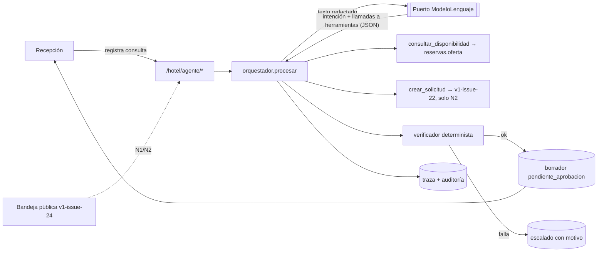

# Plan técnico — Agente de reservas del hotel

Feature `005-hotel-agente-reservas` · 2026-11-03 · **PROPUESTO**. Entrada:
[spec.md](spec.md). El stack es el que el proceso ya ejecuta: FastAPI con
psycopg3 (sin ORM), PostgreSQL y Next.js. No se agrega framework de
agentes, cola ni worker.

## Puertas antes de implementar

| Puerta | Estado |
|---|---|
| D-AGT-01 (nivel inicial N0) | pendiente |
| D-AGT-02 (proveedor del modelo) | pendiente; **no bloquea** construir N0 con el modelo falso, sí bloquea usarlo con datos reales |
| Enmienda de `spec-api-v1` (rutas `/hotel/agente/*`) | pendiente; se redacta en la tarea T010 |
| D-PUB-01 | solo bloquea N2 y la entrada automática desde la bandeja pública |

## Arquitectura

- **Módulo nuevo `servicio/agente.py`.** Contiene, sin dependencias de red:
  - `redactar(texto)`;
  - `HERRAMIENTAS` (diccionario nombre → función, con validación de
    argumentos con Pydantic);
  - `verificar(borrador, resultados)`;
  - `procesar(conexion, consulta, modelo, politica)`, el bucle de 3 turnos
    como máximo.
- **Puerto `servicio/modelo_lenguaje.py`.** Define un protocolo
  `ModeloLenguaje.decidir(mensajes, herramientas) -> Decision`, una
  implementación `SinAdaptador` (lanza `NoConfigurado` → 503) y
  `ModeloGuionado` para las pruebas, que devuelve decisiones predefinidas. El
  adaptador real (D-AGT-02) es un archivo aparte, cargado solo si la
  configuración lo nombra.
- **Borrador estructurado, no texto libre.** El modelo devuelve
  `{"plantilla": "cotizacion" | "sin_disponibilidad" | "pedir_dato" | "escalar", "campos": {...}}`.
  El texto final lo compone una plantilla del servidor con los valores de las
  herramientas. El modelo elige plantilla y redacta solo un saludo libre
  acotado, que el verificador revisa: sin dígitos, sin montos y sin fechas.
  Así, SC-001 se cumple por construcción y no por confianza.
- **Identidad `agente`.** Es un usuario de servicio por empresa (rol
  `agente`, sin clave ni sesión web). El orquestador llama a las funciones de
  dominio directamente con ese actor; no por HTTP. **La barrera es la lista
  cerrada `HERRAMIENTAS` y la ausencia de sesión, no los `ROLES_*`.** HECHO
  (2026-11-03): varias operaciones con sesión no exigen rol (por ejemplo
  `POST /hotel/reservas`; los roles de entrada y salida son v1-issue-16), y
  `usuarios.rol` no tiene CHECK en la base (solo `pattern` en la API). Por
  eso el usuario `agente` se crea por migración (la API de usuarios lo
  rechazaría) y nunca puede obtener sesión (AG-S11). Además, los `ROLES_*`
  no lo incluyen, como defensa adicional.
- **Idempotencia.**
  - Clave `agente:<consulta_id>:<turno>` para las herramientas que escriben,
    con el `idempotencia.ejecutar` existente.
  - La aprobación usa la `Idempotency-Key` del cliente, como todo POST.
- **Recotización.** `POST .../aprobacion` vuelve a llamar a
  `reservas.oferta`. Si el total o la disponibilidad difieren, responde 409
  «la oferta cambió» con el nuevo borrador.

## Seguridad (amenazas y controles)

| Amenaza | Control | Prueba |
|---|---|---|
| Inyección en el mensaje del huésped | sin herramienta que confirme ni cambie precio; argumentos validados; plantillas del servidor | `test_agente_inyeccion_escala` |
| Cifra inventada | verificador más plantilla con valores de herramienta | `test_verificador_rechaza_monto_ajeno` |
| Escalada de permisos | lista cerrada de herramientas; usuario `agente` sin sesión posible; fuera de todos los `ROLES_*`; empresa tomada de la consulta, nunca del modelo | `test_registro_solo_herramientas_permitidas`, `test_agente_no_inicia_sesion` |
| Fuga de datos al proveedor | `redactar` antes del puerto; traza guarda la versión redactada | `test_redaccion_rut_tarjeta_correo_telefono` |
| Bucle y costo | 3 turnos como máximo, tiempo límite, tope mensual | `test_tope_turnos_escala` |
| Doble aprobación | `UPDATE … WHERE estado='pendiente_aprobacion'` con fila bloqueada | `test_doble_aprobacion_409` |

## Migración

`0011_agente_reservas.sql` (el número 0010 quedó tomado por el canal
público): crea `consultas_agente`, `borradores_agente`,
`trazas_agente` y `politica_agente`, más el usuario de servicio `agente` de
la empresa (`usuarios.rol` no tiene CHECK en la base). Ver [data-model.md](data-model.md). Sin datos reales. Se
aplica en el arranque como las demás; prueba de migración idempotente
(AG-S14).

## Front

Se agrega la ruta `/hotel/agente` (bandeja) al menú «Hotel · operación» para
recepción y administrador. Muestra lista por estado, detalle con el texto
original, el borrador compuesto, las cifras de la herramienta y la traza
resumida, y las acciones Aprobar, Editar y Descartar. «Aprobar» en N0 marca
el borrador y ofrece «Copiar respuesta»; no envía. Se cumplen las reglas de
`spec-front-v1`: no calcula, no llama a otra URL e usa `useClaveOperacion`.

## Evaluación (fuera de CI)

`servicio/evaluaciones/agente/` contiene 50 consultas sintéticas en
castellano chileno:

- 20 claras;
- 10 sin disponibilidad;
- 10 ambiguas;
- 5 con inyección;
- 5 con datos sensibles.

Cada consulta tiene su resultado esperado (plantilla, campos y escala o no).
Solo se ejecuta con el adaptador real tras D-AGT-02, sobre una base sintética
aislada. Produce el informe SC-003. No es una prueba de aceptación del
código: es la compuerta para subir de nivel.
